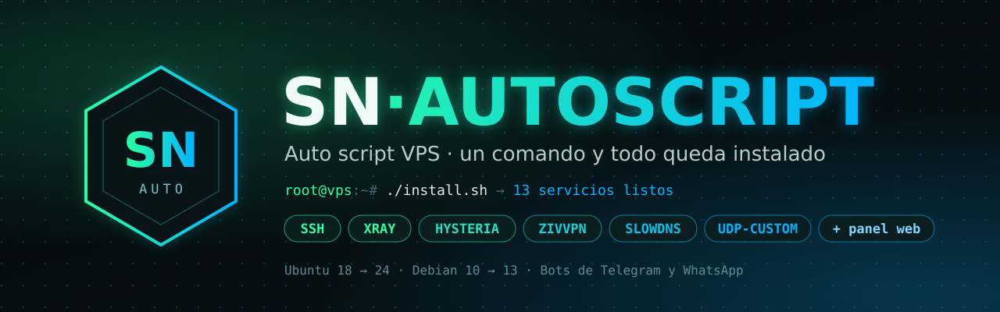

<div align="center">



<br>

[](https://t.me/SinNombreNET)
[](https://t.me/SN_PLUS)
[](#-compatibilidad)
[](#-compatibilidad)


**Auto script VPS en español: con un solo comando instala SSH, Xray (VLESS, VMess, Trojan, gRPC), Hysteria, ZivVPN, SlowDNS, UDP-Custom y más, y los administras desde un menú.**
Sin elegir módulo por módulo: al terminar la instalación ya tienes 13 servicios funcionando, con bots de Telegram y WhatsApp y panel web.

[Instalar](#-instalación) · [Protocolos](#-protocolos-y-puertos) · [Menú](#-el-menú) · [Usuarios](#-usuarios-ssh-y-xray) · [Bots](#-bots) · [Panel web](#-panel-web) · [Herramientas](#-herramientas) · [Licencia](#-licencia) · [Soporte](#-soporte)

</div>

---

## ⚡ Instalación

Entra a tu VPS como **root** y pega:

```bash
rm -rf /root/install.sh && wget --no-cache -O /root/install.sh https://raw.githubusercontent.com/SINNOMBRE22/SN-AUTOSCRIPT/main/install.sh && chmod +x /root/install.sh && /root/install.sh
```

El instalador te pide tres cosas:

1. **Key de licencia** (`SN-…`). Se activa en ese momento.
2. **Dominio** con un registro **A** que apunte a la IP de tu VPS. Con él se emite el certificado TLS.
3. **Dominio NS** (opcional). Solo si vas a usar SlowDNS.

Después instala los 13 servicios solo, uno tras otro. Cuando termine, escribe:

```bash
menu
```

> [!TIP]
> Usa una VPS **recién instalada** y deja libre el puerto **80** mientras se emite el certificado.
> Si algo falla, el registro completo queda en `/var/log/sn_autoscript_install.log`.

---

## 🛡️ Qué es SN-AUTOSCRIPT

SN-AUTOSCRIPT es el **auto script** de la familia SN PLUS: en lugar de ir instalando protocolo por protocolo, deja la VPS completa en una sola pasada y lista para vender cuentas.

- **Todo automático:** SSH, Xray, WebSocket, Dropbear, BadVPN, UDP-Custom, ZivVPN, Hysteria, SlowDNS, Shadowsocks, BHTTP, HCR y Check User quedan instalados al terminar.
- **Todo Xray en 443 y 80:** VLESS, VMess, Trojan, gRPC y XHTTP comparten los puertos de siempre. Tus clientes no tienen que abrir puertos raros.
- **Hecho en C++ y compilado estático:** abre al instante, consume muy poco y no depende de las librerías de tu sistema.
- **Los protocolos UDP conviven sin pisarse:** Hysteria, ZivVPN y UDP-Custom funcionan a la vez, cada uno en su rango, y las reglas sobreviven a reinicios.
- **Bots de Telegram y WhatsApp** con revendedores, para manejar cuentas desde el celular.
- **Panel web propio** con HTTPS: usuarios, conexiones, protocolos, terminal y respaldos desde el navegador.
- **Respaldo de usuarios** para mudarte de VPS sin que tus clientes cambien nada.

---

## 🔌 Protocolos y puertos

| Servicio | Puerto | Notas |
|:--|:--|:--|
| **SSH** | 22 | OpenSSH |
| **Xray** | 443 · 80 | Todos los protocolos Xray (ver abajo) |
| **WebSocket / SSL** | 443 · 80 · 8080 | SSH sobre WebSocket, con y sin TLS |
| **Dropbear** | 8022 | SSH ligero |
| **BadVPN-UDPGW** | 7300 | UDP para juegos y llamadas sobre SSH |
| **UDP-Custom** | 1-65535 (UDP) | Toma los puertos UDP que no usan los demás |
| **Hysteria** | 36725 · 20000-39999 | UDP de alta velocidad |
| **ZivVPN** | 7538 · 6000-19999 | ZIV / ZIP-UDP |
| **SlowDNS** | 53 | Túnel por DNS (requiere dominio NS) |
| **Shadowsocks** | 8388 | Proxy Shadowsocks |
| **BHTTP** | 8180 | Túnel BHTTP |
| **HCR** | 8280 | Túnel HCR |
| **Check User** | 8000 | Para que las apps muestren vencimiento y conexiones |

**Xray en 443 (TLS):** VLESS-TCP · VLESS-WS · VMess-WS · Trojan-WS · VLESS-gRPC · XHTTP (opcional)
**Xray en 80 (sin TLS):** VLESS-TCP · VLESS-WS · VMess-WS

Cada usuario Xray se crea en **todos** los protocolos a la vez, con sus links listos para copiar.

---

## 🧭 El menú

| # | Opción | Qué hace |
|:--:|:--|:--|
| 1 | **Usuarios SSH** | Crear, renovar, limitar y vigilar cuentas SSH |
| 2 | **V2Ray / Xray** | Usuarios Xray con links y estadísticas |
| 3 | **Protocolos** | Estado de cada servicio; reiniciar, detener, reinstalar o ver registros |
| 4 | **Herramientas y extras** | 17 herramientas del sistema y el panel web |
| 5 | **Bots de gestión** | Bot de Telegram y bot de WhatsApp |
| 6 | **Banner SSH** | Mensaje que ven tus clientes al conectarse |
| 7 | **IP y red** | Sistema, IP, dominio, RAM, CPU y disco |
| 8 | **Reseller y licencia** | Estado de la key, IP vinculada y revalidar |
| 9 | **Puertos y servicios** | Todos los puertos y los rangos UDP reales |
| 10 | **Reiniciar servicios** | Reinicia solo lo que está instalado |
| 11 | **Actualizar** | Baja la última versión sin tocar tus usuarios |
| 12 | **Desinstalar** | Quita el script y sus reglas |

La pantalla de inicio muestra en vivo CPU, RAM, disco, usuarios SSH y Xray, baneos de Fail2ban y el estado de tu licencia.

---

## 👥 Usuarios SSH y Xray

<table>
<tr>
<td valign="top" width="50%">

**🔐 SSH**
- Crear, renovar, editar y eliminar
- Usuarios temporales (por minutos)
- Usuarios programados por horario
- Bloquear y desbloquear
- Límite de conexiones por usuario
- Limitador de vencidos y su registro
- Monitor de conectados
- Detalles de cada cuenta
- Eliminar vencidos o todos en un paso

</td>
<td valign="top" width="50%">

**🌐 V2Ray / Xray**
- Crear, renovar y eliminar
- Un usuario en todos los protocolos a la vez
- Bloquear y desbloquear
- Links listos para copiar
- Estadísticas de tráfico
- Eliminar vencidos

</td>
</tr>
</table>

**💾 Respaldo de usuarios:** guarda tus usuarios SSH y V2Ray/Xray en `/root` y restáuralos en otra VPS con las mismas claves, fechas, límites y UUID. Si instalas en una VPS nueva y hay un respaldo en `/root`, el menú te avisa.

---

## 🤖 Bots

<table>
<tr>
<td valign="top" width="50%">

**Bot de Telegram**
- Crear usuarios SSH y Xray
- Cuentas de prueba
- Editar, buscar y eliminar
- Ver conectados e info de usuarios
- Eliminar vencidos
- **Revendedores** limitados por días o ilimitados
- Info de la VPS, optimizar y respaldo
- `/info` y `/speedtest`

</td>
<td valign="top" width="50%">

**Bot de WhatsApp**
- Se vincula por **QR**
- Los mismos comandos que el de Telegram: SSH, Xray, pruebas, editar, vencidos
- Revendedores
- Números administradores
- Prefijo de comandos configurable

</td>
</tr>
</table>

Los dos se instalan y se configuran desde **menú → 5**.

---

## 🖥️ Panel web

Administra la VPS desde el navegador (**menú → 4 → 17**):

- **HTTPS propio** en su puerto (4747 por defecto), con usuario y contraseña. Solo entra el dueño de la VPS.
- **Usuarios SSH:** crear, editar y renovar, IP de cada conexión, estadísticas de consumo, cortar conexiones y tarjeta con los datos de acceso.
- **Usuarios Xray** con sus links y **código QR** de cada protocolo.
- **Protocolos:** estado de cada servicio; iniciar, detener, reiniciar y ver registros.
- **Terminal en vivo** dentro del navegador.
- **Respaldos:** crear, descargar, subir y restaurar.

---

## 🧰 Herramientas

| | | |
|:--|:--|:--|
| 📊 Info del sistema | 🔌 Conexiones activas | 🚪 Puertos abiertos |
| 🏷️ Cambiar dominio | 🖥️ Cambiar hostname | 🕒 Zona horaria |
| 🚀 Optimizar red (BBR) | 💾 Respaldo de configuración | 📶 Test de velocidad |
| 🧹 Limpiar RAM y caché | 🗑️ Limpiar logs viejos | 📦 Limpiar paquetes (apt) |
| ⬆️ Actualizar sistema | 🔄 Reiniciar red | 🔑 Cambiar contraseña de root |
| 👥 Respaldo de usuarios | 🌐 Panel web | |

---

## 💻 Compatibilidad

| Sistema | Versiones |
|:--|:--|
| **Ubuntu** | 18.04 → 24.04 |
| **Debian** | 10 → 13 |

También funciona en derivados (Linux Mint, Pop!_OS). Arquitectura **x86_64 (amd64)** y acceso **root**.
Sirve en cualquier proveedor de VPS: DigitalOcean, Vultr, Contabo, Hetzner, Oracle, AWS, Google Cloud, etc.

---

## 🔑 Licencia

SN-AUTOSCRIPT se activa con una **key** durante la instalación. La key queda vinculada a la IP de tu VPS y se revalida sola cada 5 minutos.
Con un mismo plan tienes acceso a **SN PLUS** y a **SN-AUTOSCRIPT**.

<div align="center">

[](https://t.me/SinNombreNET)
[](https://wa.me/5215629885039)

</div>

---

## 🔄 Actualizar

Escribe `menu` y elige **11 · Actualizar**. Baja la última versión y reinstala solo los protocolos que ya tienes activos. No toca tus usuarios, tu dominio, tu certificado ni tu licencia.

---

## 💬 Soporte

Novedades, ayuda con la instalación y actualizaciones:

<div align="center">

[](https://t.me/SinNombreNET)
[](https://t.me/SN_PLUS)

</div>

---

## ❓ Preguntas frecuentes

<details>
<summary><b>¿Qué es un auto script para VPS?</b></summary>

Es un script que deja tu servidor listo de una vez: instala los protocolos (SSH, Xray, Hysteria, SlowDNS…), emite el certificado y te da un menú para crear usuarios, sin escribir comandos de Linux a mano.
</details>

<details>
<summary><b>¿En qué se diferencia de SN PLUS?</b></summary>

SN PLUS te deja elegir e instalar cada protocolo desde un menú de instaladores. SN-AUTOSCRIPT instala todo en una sola pasada y pone todo Xray en los puertos 443 y 80. Con un mismo plan puedes usar cualquiera de los dos.
</details>

<details>
<summary><b>¿Necesito un dominio?</b></summary>

Sí, un dominio con registro **A** apuntando a la IP de tu VPS, para el certificado TLS de Xray y SSL. El dominio **NS** solo hace falta si vas a usar SlowDNS.
</details>

<details>
<summary><b>¿Funciona en Ubuntu 24.04 y Debian 12?</b></summary>

Sí. Funciona de Ubuntu 18.04 a 24.04 y de Debian 10 a 13, en VPS x86_64.
</details>

<details>
<summary><b>¿Puedo usar Hysteria, ZivVPN y UDP-Custom al mismo tiempo?</b></summary>

Sí. Cada uno tiene su rango (Hysteria 20000-39999, ZivVPN 6000-19999 y UDP-Custom el resto) y las reglas se mantienen después de reiniciar la VPS.
</details>

<details>
<summary><b>¿Puedo vender cuentas con revendedores?</b></summary>

Sí. Desde el bot de Telegram o el de WhatsApp agregas revendedores, limitados por días o ilimitados, y ellos crean cuentas desde su celular.
</details>

<details>
<summary><b>¿Cómo cambio de VPS sin perder a mis clientes?</b></summary>

En la VPS vieja haz el **respaldo de usuarios** (menú → 4 → 16) y pásalo a `/root` de la nueva. Al restaurarlo, tus clientes siguen con las mismas claves, fechas y UUID.
</details>

---

<div align="center">

**⚡ SN-AUTOSCRIPT — un comando, todo listo**

[Instalar](#-instalación) · [Grupo de Telegram](https://t.me/SN_PLUS) · [Soporte](https://t.me/SinNombreNET)

<sub>© 2026 SinNombre · SINNOMBRE22 · familia SN PLUS</sub>

</div>
